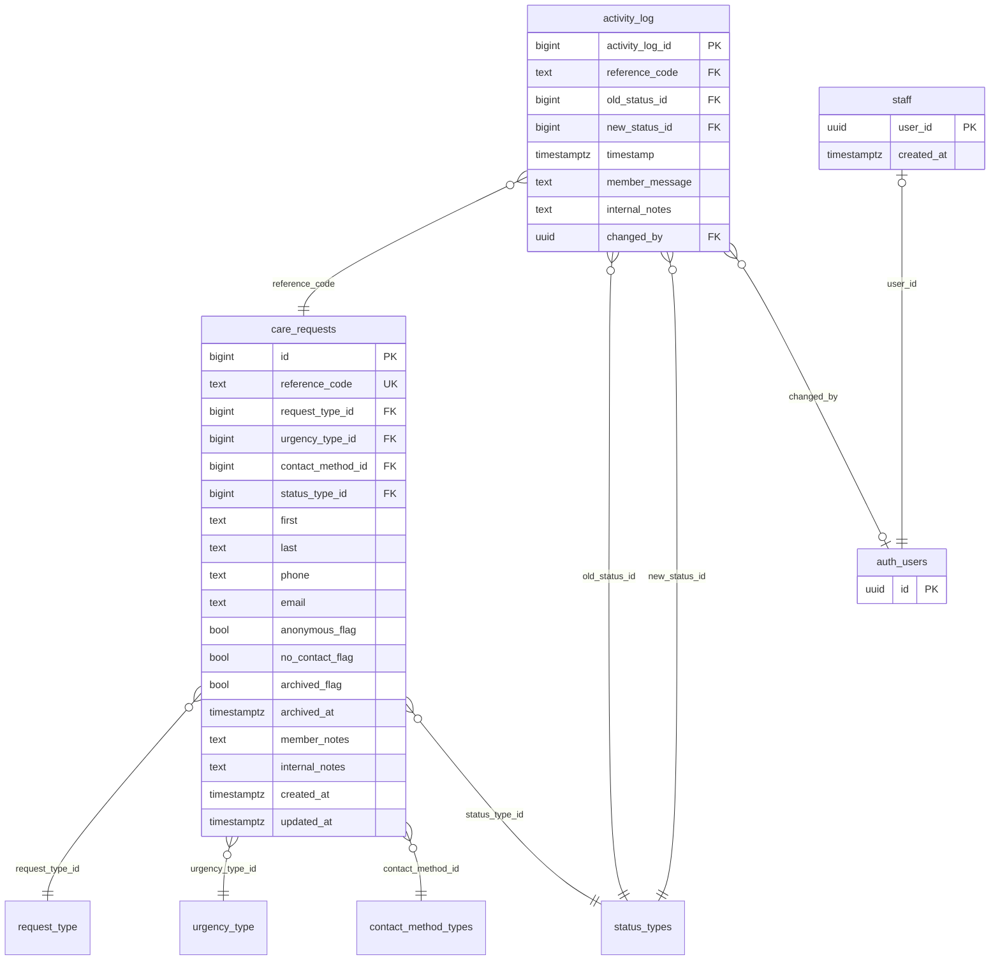

# Database Guide

This guide explains the Zion Care Requests database: what each table holds, how the tables connect, who can read or write what, and the automatic behavior (triggers) that runs behind the scenes.

The database is a Supabase project (Postgres 17). Everything the app uses lives in the `public` schema. Helper functions that should never be called from the app live in the `private` schema.

> **Schema snapshot:** matches the migrations in [supabase/migrations/](../supabase/migrations/) as of 2026-10-28. If you add a migration, update this file in the same change.

---

## Contents

1. [The big picture](#the-big-picture)
2. [Entity relationship diagram](#entity-relationship-diagram)
3. [Tables](#tables)
4. [Lookup values](#lookup-values)
5. [Who can do what (security)](#who-can-do-what-security)
6. [Public functions (RPCs)](#public-functions-rpcs)
7. [Automatic behavior (triggers)](#automatic-behavior-triggers)
8. [Common tasks with code](#common-tasks-with-code)
9. [Working with the schema](#working-with-the-schema)
10. [Gotchas](#gotchas)

---

## The big picture

The app lets **members** (the public) ask the care team for help, such as a hospital visit, a meal delivery or prayer support. **Staff** then work through those requests.

1. **A member submits a request.** They don't log in. The app calls `submit_care_request`, which saves the request with the status **Received** and returns a **reference code** such as `ZC-7K3M-9QXP`.
2. **The member checks progress.** They type their reference code. The app calls `get_care_request` and `get_request_updates` to show the status and any messages from staff. The lookup never shows names, contact details, the description or staff notes.
3. **Staff manage requests.** Staff log in with Supabase Auth. Being logged in isn't enough: their user ID must also be in the `staff` table. Staff can then read every request, change statuses and add notes.
4. **Every status change is recorded** in `activity_log`, automatically, with who made it and when.

The reference code is the member's only key to their request, so treat it like a password: never log it or show it to anyone but that member.

---

## Entity relationship diagram



`auth_users` is Supabase's built-in `auth.users` table. We don't manage it ourselves; Supabase Auth does.

There are two kinds of tables:

- **Core tables:** `care_requests`, `activity_log` and `staff`. These hold the real data.
- **Lookup tables:** `status_types`, `request_type`, `urgency_type` and `contact_method_types`. These hold short fixed lists that fill dropdowns and turn IDs into readable labels.

---

## Tables

Notation: **PK** = primary key, **FK** = foreign key (points to another table), **UK** = must be unique.

### `care_requests`

One row per request for care. This is the heart of the database.

| Column | Type | Required | Default | Notes |
| --- | --- | --- | --- | --- |
| `id` | bigint | yes | auto | PK. Internal ID; use `reference_code` to talk about a request. |
| `reference_code` | text | yes | generated | UK. Format `ZC-XXXX-XXXX`. **Always generated by the database and can never be changed.** Any value you send is ignored. |
| `request_type_id` | bigint | yes | | FK → `request_type`. What kind of help is wanted. |
| `urgency_type_id` | bigint | yes | | FK → `urgency_type`. |
| `contact_method_id` | bigint | yes | | FK → `contact_method_types`. How the member wants to be contacted. |
| `status_type_id` | bigint | yes | | FK → `status_types`. Where the request is in the workflow. |
| `first` | text | no | | First name. Max 100 characters. |
| `last` | text | no | | Last name. Max 100 characters. |
| `phone` | text | no | | 7–20 characters: digits, spaces, `( ) . -`, optional leading `+`. |
| `email` | text | no | | Must look like `a@b.c`. Max 254 characters. Saved in lowercase when submitted through `submit_care_request`. |
| `anonymous_flag` | boolean | yes | `false` | The member chose not to give their name. |
| `no_contact_flag` | boolean | yes | `false` | The member doesn't want to be contacted. |
| `archived_flag` | boolean | yes | `false` | Moves the request from the open list to the Archived view. **Set automatically** when the status becomes Completed, and cleared if it's moved off Completed. Requests are archived, never deleted. |
| `archived_at` | timestamptz | no | | When the request was archived. **Set by the database**: filled in when `archived_flag` becomes true, emptied when it becomes false. |
| `member_notes` | text | yes | | The description the member wrote when submitting. **Required**, can't be blank or only spaces, max 250 characters. Staff only: the member lookup doesn't return it. |
| `internal_notes` | text | no | | Staff-only notes. Max 250 characters. **Never shown to members.** |
| `created_at` | timestamptz | yes | `now()` | Set by the database when the row is created and can't be changed. |
| `updated_at` | timestamptz | yes | `now()` | Updated by the database on every change. |

### `activity_log`

The history of each request: one row per status change or staff update. Rows are **added, never edited or deleted** (there is no update or delete permission).

| Column | Type | Required | Default | Notes |
| --- | --- | --- | --- | --- |
| `activity_log_id` | bigint | yes | auto | PK. |
| `reference_code` | text | yes | | FK → `care_requests.reference_code`. Which request this entry belongs to. |
| `old_status_id` | bigint | yes | `1` | FK → `status_types`. Status before the change. **Filled in by the database**; don't set it yourself. |
| `new_status_id` | bigint | yes | `1` | FK → `status_types`. Status after the change. |
| `timestamp` | timestamptz | yes | `now()` | When the entry was made. |
| `member_message` | text | no | | What the notification email to the member would say about this update. **Members can see this** on the status lookup page. See [notifications](#notifications-no-email-service). |
| `internal_notes` | text | no | | Staff-only notes. Max 250 characters. **Never shown to members.** |
| `changed_by` | uuid | no | | FK → `auth.users`. The staff member who made the change. **Always set by the database** to the logged-in user, so it can't be faked. Becomes empty if that user account is deleted. |

### `staff`

The list of people allowed to manage requests. If a logged-in user's ID isn't here, they see no requests at all.

| Column | Type | Required | Default | Notes |
| --- | --- | --- | --- | --- |
| `user_id` | uuid | yes | | PK, FK → `auth.users`. If the user account is deleted, their staff row is deleted too. |
| `created_at` | timestamptz | yes | `now()` | When they were made staff. |

### Lookup tables

Each has an ID (PK, auto-numbered `bigint`, like every ID in the database) and a label. All four are readable by anyone, including logged-out visitors. They can only be changed from the Supabase dashboard (see [security](#who-can-do-what-security)).

| Table | ID column | Label column |
| --- | --- | --- |
| `status_types` | `status_type_id` | `status_type` |
| `request_type` | `request_type_id` | `request_type` |
| `urgency_type` | `urgency_type_id` | `urgency` |
| `contact_method_types` | `contact_method_type_id` | `contact_method` |

> **Naming isn't consistent.** Some tables are plural (`status_types`) and some singular (`request_type`). On `care_requests`, the column `contact_method_id` points to `contact_method_type_id`. Check the generated types if a name doesn't work.

---

## Lookup values

Current values. The app may rely on these IDs, so **don't renumber or delete them**. Rename a label or add a new row instead.

**`status_types`**: the workflow, in order

| ID | Status |
| --- | --- |
| 1 | Received *(every new request starts here)* |
| 2 | In Review |
| 3 | Assigned |
| 4 | Completed |

**`request_type`**

| ID | Type |
| --- | --- |
| 1 | Hospital Visit |
| 2 | Meal Delivery |
| 3 | Counseling Referral |
| 4 | Prayer Support |
| 5 | Other |

**`urgency_type`**: sorted by `urgency_rank`, not by ID

| ID | Urgency | Rank |
| --- | --- | --- |
| 1 | Routine | 1 |
| 2 | Soon | 2 |
| 3 | Urgent | 3 |

`urgency_rank` sets the sort order: a higher number means more urgent. It must be unique and above 0. To add a new level, give it a rank that fits between the existing ones (renumber the other ranks if needed). Its ID doesn't affect the order.

**`contact_method_types`**

| ID | Method |
| --- | --- |
| 1 | Phone |
| 2 | Email |
| 3 | Text |
| 4 | No Contact |

---

## Who can do what (security)

Supabase protects tables with **row level security (RLS)**: rules in the database that decide which rows each user can see or change. RLS is turned on for every table. A database hook (`rls_auto_enable`) also turns it on automatically for any new table in `public`, so you can't forget.

There are three kinds of caller:

- **Anonymous:** anyone using the app without logging in (the `anon` role). Members are always anonymous.
- **Logged-in staff:** logged in (the `authenticated` role) **and** listed in `staff`. The check is the `private.is_staff()` function.
- **Admin:** the Supabase dashboard or the secret key (`service_role`). This bypasses RLS completely. **Never put the secret key in the app**; it belongs on a server only.

What each caller can do directly on tables:

| Table | Anonymous | Logged in, not staff | Staff |
| --- | --- | --- | --- |
| `care_requests` | nothing | nothing | read, add, edit |
| `activity_log` | nothing | nothing | read, add |
| `staff` | nothing | read own row only | read own row only |
| lookup tables | read | read | read |

Nobody can **delete** anything through the app, and nobody can edit the lookup tables or `staff` through the app. Use the dashboard for those.

**Blocked queries don't raise errors.** When RLS blocks a read, you get an **empty list**, not an error. If a query returns nothing, first check that you're logged in as someone in `staff`.

### How members get to their own data

Members are anonymous, so RLS blocks them from `care_requests` and `activity_log` completely. Instead they go through three [public functions](#public-functions-rpcs). Those functions run with elevated permissions, but the lookups return only:

- the status;
- the request type;
- dates;
- staff messages written for the member (`member_message`).

They never return names, phone numbers, emails, the description, `internal_notes` or `changed_by`. Leaving the internal notes out is enforced in the database, not just hidden in the page. Calling the functions directly gets the same limited data. That's important because anyone who has a reference code can call them.

### Making someone staff

1. They sign up or are invited through Supabase Auth (Dashboard → Authentication → Users).
2. Copy their user UID.
3. Add it to `staff` in the Table Editor, or run this in the SQL editor:
   ```sql
   insert into public.staff (user_id) values ('<their-user-uid>');
   ```

To remove someone, delete their `staff` row. They keep their login but lose access to every request.

---

## Public functions (RPCs)

Call these from the app with `supabase.rpc('name', { ...args })`. Anonymous callers can run all three.

### `submit_care_request(...)` → `text`

Creates a request and returns its new reference code. This is the only way for a member to create one.

| Argument | Type | Required | Notes |
| --- | --- | --- | --- |
| `p_request_type_id` | bigint | yes | |
| `p_urgency_type_id` | bigint | yes | |
| `p_contact_method_id` | bigint | yes | |
| `p_first`, `p_last`, `p_phone`, `p_email` | text | no | Spaces are trimmed and blank values are saved as empty. Email is lowercased. |
| `p_anonymous` | boolean | no | Default `false`. |
| `p_no_contact` | boolean | no | Default `false`. |
| `p_member_notes` | text | **yes** | The description. Max 250 characters. Blank or only spaces is rejected. |

The status is always set to **Received** (1) and `internal_notes` is always empty, whatever the caller sends. If a value breaks a rule (for example a missing description, a bad email format or a name over 100 characters), the call fails with a Postgres error. Validate in the form too, so members see a clear message instead.

`p_member_notes` is listed with a default in the function, because Postgres needs every argument after an optional one to be optional too. But the database rejects the request if it's missing.

### `get_care_request(p_reference_code)` → one row or none

Looks up one request by reference code. Upper/lowercase and surrounding spaces don't matter, so `" zc-7k3m-9qxp "` works.

It returns only `reference_code`, `request_type` (label), `status_type_id`, `status_type` (label), `created_at` and `updated_at`. On purpose, it **doesn't** return:

- name, phone or email;
- the description;
- urgency, contact method or flags;
- `internal_notes`.

Anyone with the code can call it, so it shows nothing that would identify the member or their situation.

Archived (Completed) requests can still be looked up. It returns no rows if the code doesn't exist, which looks the same as any other wrong code, so it doesn't reveal which codes are real.

### `get_request_updates(p_reference_code)` → rows

A request's history, oldest first. Each row has the old and new status (ID and label), `member_message` and `timestamp`. It never returns `internal_notes` or `changed_by`.

---

## Automatic behavior (triggers)

Triggers are code the database runs automatically when rows change. They live in the `private` schema. **You don't call them, but you must know they exist**, because they change what you send.

### On `care_requests`

| Trigger | When | What it does |
| --- | --- | --- |
| `care_requests_archive_on_complete` | before insert / update | When the status becomes Completed (4), sets `archived_flag`. When it moves off Completed, clears it. Keeps `archived_at` in step: the time it was archived, or empty. |
| `care_requests_enforce_reference_code` | before insert / update | On insert, generates a new random reference code. On update, restores the original. **The reference code can't be set or changed by anyone.** |
| `care_requests_sync_fields` | before insert / update | Sets `created_at` and `updated_at`. `created_at` can never change. |
| `care_requests_log_status_change` | after update | If `status_type_id` changed, adds an `activity_log` row for it automatically. |

### On `activity_log`

| Trigger | When | What it does |
| --- | --- | --- |
| `activity_log_before_insert` | before insert | Sets `changed_by` to the logged-in user. Fills in `old_status_id` from the request's current status. |
| `activity_log_after_insert` | after insert | Copies `new_status_id` onto the request, so the request's status follows the log. |

### Two ways to change a status (both are safe)

**Way A: edit the request.** Update `care_requests.status_type_id`. The database adds a log entry for you, but **with no notes or message**.

**Way B: add a log entry (recommended when there's something to say).** Insert into `activity_log` with `reference_code`, `new_status_id` and any notes or message. The database fills in `old_status_id` and `changed_by`, then updates the request's status.

Neither way creates a duplicate log entry. The triggers check `pg_trigger_depth()` so they don't fire each other in a loop.

Way B also works for **adding a note without changing the status**: set `new_status_id` to the current status.

### Notifications (no email service)

The app doesn't send email. Instead, each `activity_log` row is the record of the email the member *would* get, so the table works as the notification log. Each row has:

- the reference code;
- the old and new status;
- the message (`member_message`);
- the time (`timestamp`).

Internal notes are kept in their own column (`internal_notes`) and are never part of the message. So if real email is added later, it can send `member_message` without any risk of leaking staff notes.

Use Way B whenever the member should be told something. Way A creates a log row with an empty `member_message`.

### How reference codes are made

`private.generate_reference_code()` builds `ZC-` + 4 characters + `-` + 4 characters. It picks from 31 letters and digits, leaving out `0 O 1 I L` because they're easy to confuse. That gives about 850 billion possible codes, so they're practically impossible to guess. The function picks again if a code is already taken.

---

## Common tasks with code

The client is typed from the database (`createClient<Database>` in [src/utils/supabase.ts](../src/utils/supabase.ts)). Your editor will autocomplete table and column names and flag typos. Use `Tables<'table_name'>` from [src/types/database.types.ts](../src/types/database.types.ts) to type a row.

**Fill a dropdown (anyone):**

```ts
const { data, error } = await supabase
  .from('request_type')
  .select('request_type_id, request_type')
  .order('request_type_id')
```

**Member submits a request (anyone):**

```ts
const { data: referenceCode, error } = await supabase.rpc('submit_care_request', {
  p_request_type_id: 2,
  p_urgency_type_id: 1,
  p_contact_method_id: 2,
  p_first: 'Ada',
  p_email: 'ada@example.com',
  p_member_notes: 'Recovering from surgery next week.',
})
// show referenceCode to the member and tell them to keep it
```

**Member checks their request (anyone):**

```ts
const [{ data: request }, { data: updates }] = await Promise.all([
  supabase.rpc('get_care_request', { p_reference_code: code }).maybeSingle(),
  supabase.rpc('get_request_updates', { p_reference_code: code }),
])
if (!request) {
  // no request with that code
}
```

**Staff: list open requests with labels:**

```ts
const { data, error } = await supabase
  .from('care_requests')
  .select(`
    reference_code, first, last, created_at, member_notes, internal_notes,
    request_type ( request_type ),
    urgency_type ( urgency, urgency_rank ),
    status_types ( status_type )
  `)
  .eq('archived_flag', false)
  .order('urgency_type(urgency_rank)', { ascending: false }) // Urgent, Soon, Routine
  .order('created_at', { ascending: false })
```

Urgency sorts by `urgency_rank`, not by its label or its ID. Sorting by label would be alphabetical, and IDs are only auto-numbers. `urgency_type(urgency_rank)` sorts the requests themselves by a column of the linked table, so `urgency_type` must be in the `select`. For the Archived view, use `.eq('archived_flag', true).order('archived_at', { ascending: false })`.

**Staff: change a status with a message to the member (Way B):**

```ts
const { error } = await supabase.from('activity_log').insert({
  reference_code: 'ZC-7K3M-9QXP',
  new_status_id: 3, // Assigned
  member_message: 'A volunteer will call you on Tuesday.',
  internal_notes: 'Assigned to the Tuesday meal team.',
})
```

**Staff: a request's full history, including internal notes:**

```ts
const { data, error } = await supabase
  .from('activity_log')
  .select('*, new_status:status_types!activity_log_new_status_id_fkey ( status_type )')
  .eq('reference_code', code)
  .order('timestamp')
```

`activity_log` points to `status_types` twice (old and new status), so you must say which link to follow. The `!activity_log_new_status_id_fkey` part does that.

**Staff: complete (and so archive) a request:**

```ts
const { error } = await supabase.from('activity_log').insert({
  reference_code: code,
  new_status_id: 4, // Completed: the database archives it automatically
  member_message: 'Your request is complete. We are keeping you in our prayers.',
})
```

---

## Working with the schema

### Environment variables

Copy `.env.example` to `.env` and fill in the values from Dashboard → Project Settings → API. Only `VITE_`-prefixed variables reach the browser. The **publishable** key is safe in the app; the **secret** key is not.

### Regenerate types after any schema change

```sh
npm run db:types
```

This rewrites [src/types/database.types.ts](../src/types/database.types.ts). Don't edit that file by hand.

### Migrations

The schema's history lives in [supabase/migrations/](../supabase/migrations/). The files run in filename (timestamp) order:

| File | What it does |
| --- | --- |
| `20261028134246_remote_schema.sql` | Starting point: the full schema as it was built in the dashboard (tables, constraints, policies, functions, triggers, indexes). |
| `20261028134343_request_type_id_to_bigint.sql` | Changes `request_type_id` from `integer` to `bigint` so every ID uses the same type. Rebuilds `get_care_request` and `submit_care_request` to match. |
| `20261028134846_activity_log_status_fk_restrict.sql` | Blocks deleting a status that history entries use. Before this, the delete rewrote those entries to "Received". |
| `20261028135346_drop_activity_log_member_notes.sql` | Removes `activity_log.member_notes`, which only staff could fill in. Members write in `care_requests.member_notes`; staff messages to members go in `member_message`. Rebuilds `get_request_updates` without the column. |
| `20261028135655_brief_privacy_required_description_archive.sql` | Narrows `get_care_request` to status, type and dates only, with no contact details or description. Makes the description (`member_notes`) required. Adds `archived_at`, plus a trigger that archives a request when it's Completed. |

The 12 changes made in the dashboard before the starting file were replaced by it in the history, so their names no longer appear. The starting file is the record of everything up to that point.

**Making a schema change.** Never change the schema by clicking in the dashboard. Changes made there aren't saved in the repo, and the history gets out of sync again. Instead:

```sh
npx supabase link                          # once per machine, choose this project
npx supabase migration new <short_name>    # creates supabase/migrations/<timestamp>_<short_name>.sql
# write the SQL in that file
npx supabase db push --linked --dry-run    # check only your new file would run
npx supabase db push --linked              # apply it to the live database
npm run db:types                           # refresh the TypeScript types
```

Then update this guide and commit the migration, the types and the guide together.

The `db pull` and `db push` commands need [Docker Desktop](https://www.docker.com/products/docker-desktop/) running.

**If `db push` or `db pull` complains that the history doesn't match**, someone changed the schema outside a migration file. Don't run the `migration repair` commands it suggests without understanding them; ask the team first.

---

## Gotchas

- **An empty result usually means "not allowed", not "no data".** RLS hides rows silently. See [security](#who-can-do-what-security).
- **The only staff are 3 test accounts** (`grace.staff`, `marcus.staff` and `ruth.staff`, all `@example.com`). Delete them from Dashboard → Authentication → Users before launch; deleting the account also removes its `staff` row.
- **`care_requests` holds 10 sample requests** (made-up people, `@example.com` emails, 555 phone numbers). Remove them before launch, deleting their `activity_log` rows first: `delete from activity_log; delete from care_requests;` in the SQL editor, run only while the data is all sample data.
- **Requests can't be deleted.** There's no delete permission. Also, `activity_log` points to `care_requests` without cascading, so a request that has history can't be deleted even from the dashboard until its log rows are removed. Mark it Completed instead, which archives it.
- **A status that's in use can't be deleted.** If any request or history entry uses it, the database blocks the delete, so history is never rewritten. To retire a status, rename it or stop offering it in the app instead.
- **A reference code reveals the status only.** Anyone holding a code can see that request's status, type, dates and staff messages, but never who submitted it or what they wrote. So write each `member_message` as if someone other than the member might read it.
- **"Completed" is wired to ID 4** in the archive trigger, and "Received" to ID 1 in `submit_care_request`. Don't renumber statuses.
- **Nothing limits how often `submit_care_request` is called.** If spam becomes a problem, add a CAPTCHA (Supabase Auth supports one) or a rate limit in front of it.
- **The flags aren't enforced.** For example, nothing stops `anonymous_flag = true` with a name filled in, or `no_contact_flag = true` with a contact method other than "No Contact". The app has to keep these consistent.